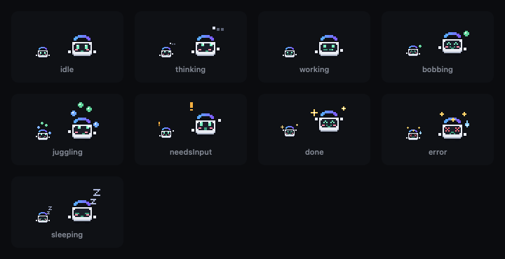

<p align="center"></p>

# CrossAgent

One window, every workstation. CrossAgent is a native macOS app that puts Claude Code (or a plain shell) on your Mac and on your Linux box side by side, in one grid of terminal panes. Remote panes go over plain `ssh`, and every pane lives in tmux on its own host, so closing the window never kills your work. Open it again and everything reattaches.

Everything starts from a project folder. Around that you get three modes: **Panes** for your terminals, **Station** to see every session on both machines at once, and **Orchestrator**, a live graph of Claude agents working on the project, with a small pixel mascot named Patch keeping an eye on them. A Claude Code skill splits work across the two machines for you, and live sync keeps the project the same on both.

<p align="center"></p>

## What you need

- A Mac on macOS 14+ (Apple Silicon), with Xcode or the Swift toolchain.
- tmux on the Mac (`brew install tmux`).
- A Linux box you can reach with a plain `ssh <alias>`, ideally with key auth, plus tmux and Claude Code on it. No server or agent to install, CrossAgent just runs `ssh`.
- Claude Code on both machines if you want Claude panes.

## Install

```sh
git clone <this repo> CrossAgent && cd CrossAgent
swift build -c release && scripts/bundle.sh
open build/CrossAgent.app        # or drag it into /Applications
```

On first launch it writes `~/.config/crossagent/hosts.json`:

```json
{"hosts": [
  {"id": "mac", "name": "This Mac", "type": "local", "accent": "#6ea8fe"},
  {"id": "pc",  "name": "Linux PC", "type": "ssh", "target": "pc", "accent": "#5fd39a"}
]}
```

`target` is anything `ssh` understands, usually a `Host` alias from `~/.ssh/config`. Add more hosts if you have them.

## Projects

CrossAgent opens on a welcome screen: hit **Open a project folder**, pick from your recent projects, or drop a folder on the window. `Cmd+O` and File > Open Recent work from anywhere, and the project name in the top bar is a switcher.

Once a project is open:

- The top bar shows the project and its folder (click to reveal it in Finder). With sync on, it also shows where the project lives on the PC.
- New panes start in the project folder on both machines: the Mac path locally, the synced path on the PC. If the folder isn't on the PC yet, CrossAgent offers to start sync or to open in your PC home folder instead.
- Panes, mode, the orchestrator and node positions are saved per project. Switch projects and the other one's tmux sessions keep running, and switching back reattaches them. The last project reopens when you launch the app.

## Panes

- Hit `Cmd+T`, pick a host and Claude or Shell, press Enter. The pane opens right away and goes live once the host answers.
- Each pane runs in a tmux session named `ca-<project>-<host>-<n>` on that host. Close a pane and the session keeps running. Kill it for real with Option+click on the close button, or right click the header and pick Kill Session.
- Quit the app and relaunch: every pane comes back attached to the same tmux session, history and all.
- If a session ends, the pane says so and gives you a Reconnect button.
- Double click a pane header (or `Cmd+Enter`) to maximize it.

### Broadcast and relay

- **Broadcast** (`Cmd+Shift+B`): what you type in the focused pane goes to every live pane. A thin accent bar at the top tells you it's on.
- **Relay** (`Cmd+Shift+R`): select text in one pane and send it to another, say a stack trace from a Mac pane into Claude on the PC. It's pasted without hitting Enter, so you can add to it first.

## Station

`Cmd+Shift+V` or Station in the top bar's mode switch. It's a wall of every `ca-*` tmux session on every host, live:

- a small live preview of each session's screen
- host, session name, and how long it's been running
- status: running, idle, needs input (Claude is waiting on a prompt), or exited

It also picks up `ca-*` sessions you didn't open from this window, like ones the skill started, ones from other projects, older `ca-<host>-<n>` sessions, or ones you made by hand. Click any tile (or arrow to it and press Enter) to jump in full size. Esc goes back. Claude Code processes running outside tmux show in a strip at the bottom so you know they exist, but you can't attach to them.

## Orchestrator

`Cmd+Shift+O` or Orchestrator in the mode switch. Pick a host (the Mac by default) and hit **Start orchestrator**. That opens a real Claude Code session for this project in tmux (`ca-<project>-<host>-orch`), drawn as the box in the middle of a canvas. Give it work, and every agent it brings in shows up around it:

- **Built-in subagents** that Claude Code launches with its Agent tool.
- **Workers** the crossagent skill starts with `ca run`, on the Mac or the PC. Each has its own terminal.

New agents pop out of the orchestrator and drift into place along their cable. Each node shows its name, a Mac or PC badge, and one line of what it's doing ("Running swift build", "Editing PaneView.swift"). You can see at a glance which state each one is in:

| State | What you see |
| --- | --- |
| thinking | soft pulsing outline |
| working | the current tool or command |
| needs input | amber, with an Answer button |
| sending or receiving | particles running along the cable, which lights up in the host colour |
| waiting | "Waiting on <names>" |
| idle | a floating zzz |
| done | a check mark, then it fades back into the orchestrator. The latest ones stay small and faded until you hit Clear finished |
| error | red edge, hover for the error line |

Drag empty space (or scroll) to pan, pinch or `Cmd`+scroll to zoom, drag nodes to arrange them, and double click empty space to recenter. Positions are saved per project.

Click a node to open it:

- **The orchestrator and workers** open their live terminal, and you type straight into it.
- **Built-in subagents** don't have a terminal of their own. You get their prompt, their recent tool calls and output, and a box to write to them. Whatever you write goes to the orchestrator as `@<name> ...`.

Option-drag from one node onto another (or drag the small handle on a node's edge) to send it some text. It's the relay from Panes, so a selection in the source terminal is filled in for you.

### How the hooks work

The canvas is built from Claude Code hooks. When you start the orchestrator, CrossAgent:

- copies one small Python script to `~/.crossagent/bin/crossagent-hook.py` on both machines.
- adds hooks for that script to the project's `.claude/settings.local.json` (local, not committed). Your own hooks in that file stay as they are. If the PC already has the project folder, its copy gets them too.

The hooks run async, so Claude never waits on them. Each call adds one short JSON line (time, session, event, agent, tool, a one-line summary) to `~/.crossagent/events/<session>.jsonl` on that machine. Workers started with `ca run` add their own start and finish lines. The app follows the Mac files directly and the PC files through one ssh connection over the existing control master. Event files are trimmed as they grow and cleared after 3 days. Only sessions CrossAgent tagged (the orchestrator, its subagents and `ca run` workers) show up. Any other Claude session in the same folder doesn't.

To take the hooks out, use **Orchestrator > Turn Off Orchestrator for This Project**. It removes only CrossAgent's entries, on both machines, and leaves the rest of the file alone.

### Patch

<p align="center"></p>

Patch sits on top of the orchestrator and reacts to the whole graph. It breathes and blinks when things are quiet, looks up with little dots while the orchestrator thinks, types while it works, and bobs along with one agent. With two or more agents running it juggles one orb per agent, coloured by host. It hops and waves with a "!" when something needs your answer, celebrates when an agent finishes, gets dizzy on an error, and falls asleep after a minute of nothing. It's drawn in code from pixel grids, and its frames loop on Core Animation, so it costs next to nothing. Hide it with **Orchestrator > Show Mascot**.

## Shortcuts

| Keys | What it does |
| --- | --- |
| `Cmd+O` | Open a project |
| `Cmd+T` | New pane (last used host preselected, Enter to open) |
| `Cmd+W` | Close focused pane (the tmux session keeps running) |
| `Cmd+Shift+[` / `Cmd+Shift+]` | Previous / next pane |
| `Cmd+1` ... `Cmd+9` | Focus pane by number |
| `Cmd+Enter` | Maximize / restore |
| `Cmd+Shift+B` | Broadcast on / off |
| `Cmd+Shift+R` | Relay selection to another pane |
| `Cmd+Shift+V` | Station (again to go back) |
| `Cmd+Shift+O` | Orchestrator (again to go back to Panes) |

They all work while a terminal has focus.

## The crossagent skill

`skills/crossagent` is a Claude Code skill that spreads work across both machines. Install it on both:

```sh
skills/crossagent/install.sh          # copies to ~/.claude/skills/crossagent on the Mac and on the PC
skills/crossagent/install.sh --mac    # or just one side (--pc)
```

Then inside any project, ask Claude Code to use it ("use crossagent to run the tests on my pc and build locally", or just "/crossagent"). It will:

- drop a `CROSSAGENT.md` in the project and point the project's `CLAUDE.md` at it. That file holds the split rules: heavy builds, test suites, long runs, Linux and docker work go to the PC, while UI, Xcode, macOS stuff and quick edits stay on the Mac. Independent pieces run on both at once.
- map your machines into `~/.config/crossagent/system-map.md` (OS, CPU, RAM, disk, tools, paths, how to reach each, where the project lives on each), keep it in sync on both machines, and put a copy in `.crossagent/` (gitignored) in the project.
- keep the project synced to the PC (live with Mutagen, see Sync below) and run each piece in a tmux session named `ca-<project>-<host>-<task>`. They show up in the station on their own, and as worker nodes in Orchestrator mode.

By default it splits across both machines. Name a machine to keep it on one:

- Mac only: "local", "mac", "this mac", "on my mac"
- PC only: "pc", "ssh", "overseas", "my pc", "on my pc"

Under the hood it's one script you can use yourself:

```sh
~/.claude/skills/crossagent/scripts/ca init
~/.claude/skills/crossagent/scripts/ca run pc tests -- make test
~/.claude/skills/crossagent/scripts/ca run mac build -- make build
~/.claude/skills/crossagent/scripts/ca run pc refactor --claude "split utils.py into modules"
~/.claude/skills/crossagent/scripts/ca wait pc tests mac build
~/.claude/skills/crossagent/scripts/ca status
```

`ca help` lists the rest.

## Sync

When the skill splits work across both machines, it mirrors the project live with
[Mutagen](https://mutagen.io) over your existing `ssh pc`. Same path on both sides
(`~/Projects/app` on the Mac is `~/Projects/app` on the PC), two-way, so a file one machine
writes shows up on the other a second or two later (over a slow tunnel, more like 1 to 2 s).

Install it once on the Mac. It copies its own small agent to the PC the first time it connects.

```sh
brew install mutagen-io/mutagen/mutagen
mutagen daemon register     # start the daemon at login
```

The safety rules:

- Git stays on the Mac. `.git` never syncs and the PC never commits or pushes in a synced folder.
- Secrets stay put: `.env`, `.env.*`, `*.pem`, `*.key` and `id_*` don't sync unless a project opts in
  with `sync_allow=.env.shared` in its `.crossagent/project`.
- Build output and dependencies (`node_modules`, `.build`, `build`, `target`, `dist`, `.venv` and
  friends) are per machine. Each side builds its own.
- Conflicts are never auto resolved. Mutagen runs in `two-way-safe` mode, so if both sides change
  the same file, nothing gets overwritten. `ca` stops handing off work and tells you.

```sh
ca sync start [path]    # start (or resume) live sync for a project, safe to run twice
ca sync status          # one line per project: watching, syncing, conflicts or errors
ca sync flush           # sync right now and wait (ca run and ca wait do this for you)
ca sync conflicts       # what clashed, with size, time and a short diff from both sides
ca sync stop [path]     # stop syncing, files stay on both machines
```

`ca init` starts sync for you unless you named one machine ("on my mac", "on my pc"). The top
bar shows a small Sync dot while any `ca-*` session is running: green is in sync, amber is
syncing or paused, red is a conflict or error. Click it for the details.

## How it works

- SwiftUI app, one window. Terminals are [SwiftTerm](https://github.com/migueldeicaza/SwiftTerm) `LocalProcessTerminalView`s, each running a real PTY.
- Local panes run `$SHELL -lc '<script>'`. Remote panes run `/usr/bin/ssh -tt <target> 'exec $SHELL -lc <script>'`, so your ssh config, keys and agent just work.
- The script is `tmux new -A -s <session> claude` (or a shell), falling back to plain `claude` if tmux is missing.
- ssh connections share one master per host (`ControlMaster`), so new panes skip the handshake.
- The station polls each host with one `tmux list-panes` plus `capture-pane` round trip, about every 1.5 s while it's open and every 10 s otherwise.

## Development

```sh
swift build && swift test
CROSSAGENT_AUTOMATION=1 .build/debug/CrossAgent    # dev hook, drive it with scripts/automation.sh
```

Design notes and judgment calls live in `docs/DECISIONS.md`, and the spec is in `docs/SPEC.md`.

## License

MIT
