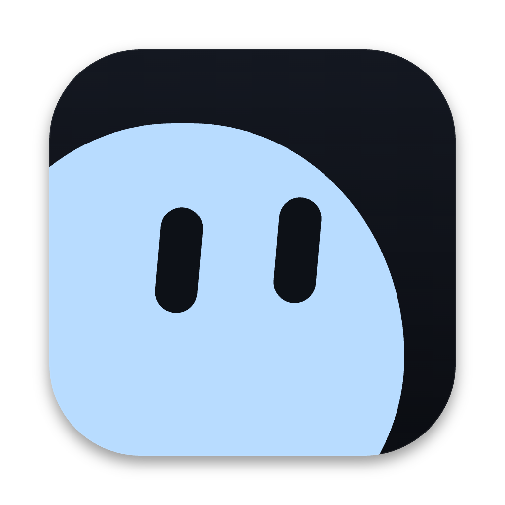
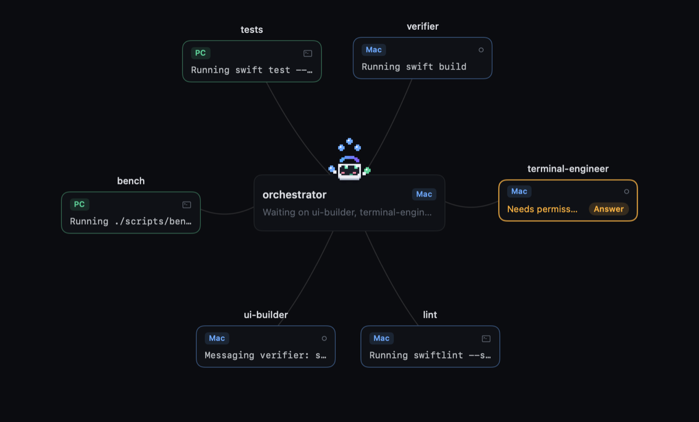
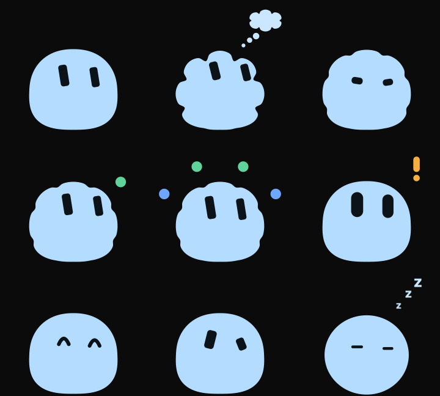

<p align="center"></p>

# CrossAgent

One window, every workstation. CrossAgent is a native macOS app that puts Claude Code (or a plain shell) on your Mac and on your other machines (Linux boxes or other Macs) side by side, in one grid of terminal panes. Remote panes go over plain `ssh`, and every pane lives in tmux on its own host, so closing the window never kills your work. Open it again and everything reattaches.

Everything starts from a project folder, and each project gets its own window with tabs: **Panes** for your terminals, **Station** to see every session on both machines at once, **Orchestrator**, a live graph of Claude agents working on the project with a little blob named Puff keeping an eye on them, **Sessions** for every Claude Code session on both machines (even ones you started in Ghostty or over plain ssh), **Activity** with both machines added up as one Super-Max Computer, and a tab for any agent you open. A Claude Code skill splits work across the two machines for you, and the Crossover Portal keeps the project the same on both.

The examples below use one remote Linux box with the host id `pc`, so you'll read "the PC" a lot. Yours can be called anything, and you can have more than one.

<p align="center"></p>

## Requirements

- macOS 14 or later on Apple Silicon.
- The Swift toolchain (Xcode or the command line tools). There's no signed download yet: you build the app from source and it runs unsigned on your own Mac.
- tmux on the Mac (`brew install tmux`).
- Claude Code on every machine where you want Claude panes or workers.
- python3 on every machine (macOS ships one, every Linux distro too). The hook and the skill use the standard library only.
- Optional: one or more remote machines, Linux or another Mac, that you can reach with a plain `ssh <alias>` and key auth, with tmux and Claude Code on them. Nothing else gets installed there, CrossAgent just runs `ssh`.
- Optional: [Mutagen](https://mutagen.io) (`brew install mutagen-io/mutagen/mutagen`) for the Crossover Portal, the live project sync between machines.

## Quick start

```sh
git clone <this repo> CrossAgent && cd CrossAgent
swift build -c release && scripts/bundle.sh
open build/CrossAgent.app        # or drag it into /Applications
```

The app isn't signed, so if macOS complains the first time, right click it in Finder and pick Open.

On first launch CrossAgent asks for a remote machine: give it an ssh target (a `Host` alias from `~/.ssh/config`, or `user@host`) and a name, hit **Test**, then **Add**. Or **Skip** and use just this Mac. You can add more later with **Add Remote Machine...**. Hosts live in `~/.config/crossagent/hosts.json`:

```json
{"hosts": [
  {"id": "mac",  "name": "This Mac",  "type": "local", "accent": "#6ea8fe"},
  {"id": "box",  "name": "Build box", "type": "ssh", "target": "box", "accent": "#5fd39a"}
]}
```

Any number of hosts, any ids (letters, digits, `-` and `_`). `target` is anything `ssh` understands.

Then open a project folder and hit `Cmd+T` for a pane on any host.

To let Claude Code split work across your machines, install the skill too (it reads the same hosts.json, and asks for a remote machine if there isn't one yet):

```sh
skills/crossagent/install.sh               # this Mac and every ssh host in hosts.json
```

Then in any project, ask Claude Code to "use crossagent", or type `/crossagent`.

## Projects

CrossAgent opens on a welcome screen: hit **Open a project folder**, pick from your recent projects, or drop a folder on the window. `Cmd+O` and File > Open Recent work from anywhere, and so do the recents under the project name in the top bar.

Once a project is open:

- The top bar shows the project and its folder (click to reveal it in Finder). With the Portal open, it also shows where the project lives on the PC.
- New panes start in the project folder on both machines: the Mac path locally, the mirrored path on the PC. If the folder isn't on the PC yet, CrossAgent offers to open the Portal or to open in your PC home folder instead.
- Each project opens in its own window, like Xcode, with its own tabs, panes, orchestrator and node positions. Opening a project that's already open brings its window forward instead of making a second one, and the welcome window makes way for the first project.
- The Window menu lists your project windows and ``Cmd+` `` cycles through them. Merge them into one window with Window > Merge All Windows if you like native tabs.
- Quit and relaunch: every project that was open comes back in its own window, with its tabs, layout and window frame. Closing one window of several closes just that project (its tmux sessions keep running). Closing the last one quits, and it reopens next time.
- The things that watch your machines (activity sampling, tmux status, session discovery, the Portal) are shared by all windows, so three windows don't cost three times as much.

## Tabs

Each project window has one tab per thing you have open, like a browser: Panes, Station, Orchestrator, Sessions, Activity, and agent chats. `Cmd+1` to `Cmd+9` jump to a tab, `Cmd+Shift+[` / `]` step through them, `Cmd+W` closes one, drag to reorder, middle click to close. Hidden tabs keep their terminals running, scrollback and all.

Click an agent anywhere it shows up small (a node on the canvas, a station tile, a chip in the tab strip, an orb around Puff, a row in Activity) and its chat opens as a tab, or the existing tab comes forward:

- the orchestrator and `ca run` workers open their live terminal, focused and ready to type.
- built-in subagents open a card with their prompt, tool calls and result, plus a box that messages them through the orchestrator.

## Panes

- Hit `Cmd+T`, pick a host and Claude or Shell, press Enter. The pane opens right away and goes live once the host answers.
- Each pane runs in a tmux session named `ca-<project>-<host>-<n>` on that host. Close a pane and the session keeps running. Kill it for real with Option+click on the close button, or right click the header and pick Kill Session.
- Quit the app and relaunch: every pane comes back attached to the same tmux session, history and all.
- If a session ends, the pane says so and gives you a Reconnect button.
- Double click a pane header (or `Cmd+Enter`) to maximize it. A lone or maximized pane goes edge to edge with no header; its controls fade in when you point at the top.
- The terminal behaves like a native one: `Cmd+C` / `Cmd+V` / `Cmd+A`, `Cmd+K` to clear (scrollback included), `Cmd+F` to find, Option as Meta, `Cmd`+click on links, trackpad scrolling through history, and right click for the usual menu. Rows use the same line height as Terminal.app and Ghostty.

### Broadcast and relay

- **Broadcast** (`Cmd+Shift+B`): what you type in the focused pane goes to every live pane. A thin accent bar at the top tells you it's on.
- **Relay** (`Cmd+Shift+R`): select text in one pane and send it to another, say a stack trace from a Mac pane into Claude on the PC. It's pasted without hitting Enter, so you can add to it first.

## Station

`Cmd+Shift+V` or the `+` menu in the tab strip. It's a wall of every `ca-*` tmux session on every host, live:

- a small live preview of each session's screen
- host, session name, and how long it's been running
- status: running, idle, needs input (Claude is waiting on a prompt), or exited

It also picks up `ca-*` sessions you didn't open from this window, like ones the skill started, ones from other projects, older `ca-<host>-<n>` sessions, or ones you made by hand. Click any tile (or arrow to it and press Enter) to jump in full size. Esc goes back. Other Claude Code sessions in this project, the ones CrossAgent didn't start, show in a strip at the bottom. Click one to attach it (if it's in tmux) or watch it (see Sessions).

## Orchestrator

`Cmd+Shift+O` or the `+` menu in the tab strip. Pick a host (the Mac by default) and hit **Start orchestrator**. That opens a real Claude Code session for this project in tmux (`ca-<project>-<host>-orch`), drawn as the box in the middle of a canvas. Give it work, and every agent it brings in shows up around it:

- **Built-in subagents** that Claude Code launches with its Agent tool. That's all local work: no extra Claude processes, they live inside the orchestrator's session.
- **PC workers**: a `pc-worker` subagent that hands a task to a headless Claude Code on the PC (see the crossagent skill below). The Mac side subagent and the PC side worker are one node with a PC badge.
- **Command workers** the crossagent skill starts with `ca run` (builds, tests, scripts), on the Mac or the PC. Each has its own terminal.

New agents pop out of the orchestrator and drift into place along their cable. Each node shows its name, a Mac or PC badge, and one line of what it's doing ("Running swift build", "Editing PaneView.swift"). You can see at a glance which state each one is in:

| State | What you see |
| --- | --- |
| thinking | soft pulsing outline |
| working | the current tool or command |
| needs input | amber, with an Answer button |
| sending or receiving | particles running along the cable, which lights up in the host colour |
| waiting | "Waiting on <names>" |
| idle | a floating zzz |
| done | a check mark, then it fades back into the orchestrator. The latest ones stay small and faded until you hit Clear finished |
| error | red edge, hover for the error line |

Drag empty space (or scroll) to pan, pinch or `Cmd`+scroll to zoom, drag nodes to arrange them, and double click empty space to recenter. Positions are saved per project.

Click a node to open it in a tab:

- **The orchestrator and command workers** open their live terminal, and you type straight into it.
- **PC workers** open with three tabs: **Terminal** (its live tmux session on the PC, where the headless worker's feed scrolls by), **Brief** (exactly what the orchestrator told it, follow-ups included) and **Result** (its last report).
- **Approvals:** when a PC worker wants to run something that needs permission, its node turns amber and an approval card shows up on the card and in a strip at the top of the canvas. **Allow** or **Deny**. No answer in 5 minutes means denied.
- **Built-in subagents** don't have a terminal of their own. You get their prompt, their recent tool calls and output, and a box to write to them. Whatever you write goes to the orchestrator as `@<name> ...`.

Option-drag from one node onto another (or drag the small handle on a node's edge) to send it some text. It's the relay from Panes, so a selection in the source terminal is filled in for you.

### How the hooks work

The canvas is built from Claude Code hooks. When you start the orchestrator, CrossAgent:

- copies one small Python script to `~/.crossagent/bin/crossagent-hook.py` on both machines.
- adds hooks for that script to the project's `.claude/settings.local.json` (local, not committed). Your own hooks in that file stay as they are. If the PC already has the project folder, its copy gets them too.

The hooks run async, so Claude never waits on them. Each call adds one short JSON line (time, session, event, agent, tool, a one-line summary) to `~/.crossagent/events/<session>.jsonl` on that machine. Workers started with `ca run` add their own start and finish lines, and PC workers add their start, activity, approval and finish lines on the PC. The app follows the Mac files directly and the PC files through one ssh connection over the existing control master. Event files are trimmed as they grow and cleared after 3 days. Only sessions CrossAgent tagged (the orchestrator, its subagents and `ca run` workers) show up. Any other Claude session in the same folder doesn't.

To take the hooks out, use **Orchestrator > Turn Off Orchestrator for This Project**. It removes only CrossAgent's entries, on both machines, and leaves the rest of the file alone.

### Puff

<p align="center"></p>

Puff is a soft, chunky, light blue blob with two dark leaning eyes. It sits on top of the orchestrator and reacts to the whole graph: it blinks and glances around when things are quiet, puffs up into a little cloud with a thought bubble while the orchestrator thinks, narrows its eyes and bounces while it works, bobs along with one agent and juggles one orb per agent (in its host colour) when there are more. It goes wide eyed with a little hop when something needs your answer, squishes happily with closed eyes when an agent finishes, wobbles on an error, and nods off with a soft "z z z" after a quiet minute.

Point at it and it watches the pointer. Poke it and it squishes, spins, wobbles or peeks, more wildly the faster you click. Click an orb to open that agent. It's drawn from vector paths that morph between shapes on Core Animation, so it's crisp at any size and costs next to nothing. Hide it with **Orchestrator > Show Mascot**.

## Sessions

The Sessions tab (View > Sessions) lists every Claude Code session on both machines, wherever it was started: a CrossAgent pane, a plain tmux session, Ghostty, Terminal, VS Code, or a plain ssh login on the PC. Recent ones that already ended are there too (the last 7 days). Each row shows the host, project, title or first prompt, status (running, waiting for input, idle, ended), how long it's been going, how many subagents it has and where it runs. By default you see the sessions for this window's project; flip **All projects** to see everything, grouped by project.

Click one and it opens in a tab:

- **In tmux** (any tmux session, not only `ca-*`): its terminal attaches right there.
- **Running in another terminal**: a read only **Live view**. It follows the conversation as it happens (your prompts, Claude's replies, tool calls and results, with subagent work tagged), and the Agents toggle shows its subagents on the canvas, spawning, working and finishing just like the orchestrator's. The header says where it's really running, like "Watching, running in Ghostty". Another app owns that terminal, so you can't type into it from here.
- **Ended**: the transcript, read only.

**Continue here** resumes that exact conversation in a CrossAgent tmux pane on the same machine (`claude --resume <id>` in the same folder), so it survives from then on. If the original is still open, the button stays off and tells you to close it there first, so two copies don't write to the same conversation. CrossAgent never kills it for you. Once it's closed, the button wakes up by itself, or you can say you've closed it.

The Orchestrator tab can show any of these sessions too: pick one at the top and its subagents become the nodes.

How it works: Claude Code keeps a small file per running session (`~/.claude/sessions/<pid>.json`, with its session id, folder and status) and a transcript per session (`~/.claude/projects/<folder>/<id>.jsonl`, plus one file per subagent). CrossAgent only reads them. Where a session runs comes from walking its parent processes. The PC is scanned with one ssh command per poll, a Live view tails the files from where it left off (one ssh stream on the PC, not one per file), and nothing polls unless a Sessions list or Live view is on screen. Limits: it reads what this Claude Code version writes, so a future format change may need an update, and live status on ssh hosts needs Linux.

## Activity

The Activity tab opens with the **Super-Max Computer**: one card that adds both machines up as one, with a Mac half and a PC half linked by the portal ring. Cores and threads across both, combined CPU load (weighted by thread count), memory used of the combined total, each GPU with its load (the Mac's GPU with its unified memory, the PC's GeForce with its VRAM), storage free across both main drives, and the hottest spot with which machine it's on. It's honest about it: "Two machines working as one through CrossAgent". Specs are read on each machine at runtime, not hardcoded. A machine that drops off leaves the totals and stays dimmed with its last known specs.

Below it, both machines side by side, and a compact Super-Max readout in the top bar (`16c/24t 23% · 30/64 GB`, both machines added up as one computer) opens it:

- CPU in total and per core cluster (performance and efficiency on the Mac, every core on the PC), memory used with pressure, swap, and temperatures (the SoC, SSD and battery on the Mac, Tctl, the NVMe and the GPU on the PC), each with a sparkline of the last few minutes.
- The `ca-*` sessions using the most CPU on each machine. Click one to open it.

The Mac reads its own counters and sensors (no root needed). The PC streams `/proc`, `/sys/class/hwmon` and, if it's there, `nvidia-smi` through one ssh connection over the existing control master, without installing anything. Sampling only runs while the tab or the readout is on screen.

## Themes

CrossAgent ships with two themes, Default and Mono. Pick one in Settings or under View > Theme. It applies right away, including running terminals.

Your own themes go in `~/.config/crossagent/themes/` as `.json` files. View > Theme > Reveal Themes Folder creates the folder and opens it. Edits show up live, no restart needed. A file that can't be read is skipped, and a toast tells you why.

You only need the colours you want to change. Anything you leave out comes from Default. If `name` is missing, the file name is used. A theme with the same name as a built-in one replaces it.

Colours are hex: `#rrggbb`, or `#rrggbbaa` for see-through ones.

```json
{
  "name": "Dusk",
  "ui": {
    "window": "#0b0c0f", "surface": "#0f1115", "raised": "#14171c",
    "border": "#ffffff12", "hairline": "#ffffff0d",
    "text": "#d7dae0", "muted": "#8a909c", "faint": "#5b616c",
    "accent": "#6ea8fe", "success": "#5fd39a", "warning": "#f5b041",
    "danger": "#f07178", "broadcast": "#ff9f6e",
    "synced": "#8fd694", "chip": "#ffffff0a", "chipHover": "#ffffff14"
  },
  "terminal": {
    "background": "#0f1115", "foreground": "#d7dae0",
    "cursor": "#9aa4b2", "selection": "#00a6b2", "selectionForeground": "#000000",
    "ansi": ["#000000", "#c23621", "#25bc24", "#adad27", "#492ee1", "#d338d3", "#33bbc8", "#cbcccd",
             "#818383", "#fc391f", "#31e722", "#eaec23", "#5833ff", "#f935f8", "#14f0f0", "#e9ebeb"]
  },
  "mascot": { "body": "#b3dcff", "eyes": "#0b1218" },
  "hosts": { "pc": "#5fd39a" }
}
```

- `ui`: the window chrome. `surface` is the pane background, `raised` is for popovers and cards. `border` and `hairline` are usually see-through. `synced` falls back to `success`. `chip` and `chipHover` fall back to `text` at low opacity.
- `terminal`: what the terminals show. `ansi` needs exactly 16 colours: black, red, green, yellow, blue, magenta, cyan, white, then the bright versions in the same order. `selectionForeground` falls back to black.
- `mascot`: the little guy's body and eyes.
- `hosts`: optional. Overrides a host's accent colour from `hosts.json`, keyed by host id. Hosts you don't list keep their own colour.

## Shortcuts

| Keys | What it does |
| --- | --- |
| `Cmd+O` | Open a project (or bring its window forward) |
| ``Cmd+` `` | Next project window |
| `Cmd+Shift+W` | Close the window (and its project) |
| `Cmd+T` | New pane (last used host preselected, Enter to open) |
| `Cmd+W` | Close the tab (in Panes: close the focused pane, its tmux session keeps running) |
| `Cmd+1` ... `Cmd+9` | Go to tab by number |
| `Cmd+Shift+[` / `Cmd+Shift+]` | Previous / next tab |
| `Ctrl+1` ... `Ctrl+9` | Focus pane by number |
| `Cmd+Option+[` / `Cmd+Option+]` | Previous / next pane |
| `Cmd+Enter` | Maximize / restore |
| `Cmd+Shift+B` | Broadcast on / off |
| `Cmd+Shift+R` | Relay selection to another pane |
| `Cmd+Shift+V` | Station |
| `Cmd+Shift+O` | Orchestrator |
| `Cmd+K` / `Cmd+F` | Clear / find in the focused terminal |

They all work while a terminal has focus.

## The crossagent skill

`skills/crossagent` is a Claude Code skill that spreads work across both machines. Install it on both:

```sh
skills/crossagent/install.sh               # this Mac and every ssh host in hosts.json
skills/crossagent/install.sh --local       # just this Mac
skills/crossagent/install.sh --host pc     # just one host (repeat for more)
```

Then inside any project, ask Claude Code to use it ("use crossagent to run the tests on my pc and build locally", or just "/crossagent"). `ca init` sets the project up without starting anything:

- drops a `CROSSAGENT.md` in the project and points the project's `CLAUDE.md` at it. That's the playbook for the orchestrator (below).
- generates a `<host>-worker` subagent per ssh host in `~/.claude/agents/` (`pc-worker` here) and keeps agent teams in-process for the project.
- maps your machines into `~/.config/crossagent/system-map.md` (OS, CPU, RAM, disk, tools, paths, how to reach each) on both machines, with a copy in `.crossagent/` (gitignored).
- opens the Crossover Portal so the project is mirrored to the PC (see below).

### How orchestration works

The Claude Code session you talk to is the orchestrator. It splits the work and stays in charge.

- **Work on the Mac** goes to Claude Code's own subagents (the Agent tool, background agents, your `.claude/agents`). They show up in Claude's agent list as usual and as nodes on the canvas. No new `claude` processes or tmux sessions.
- **Work on the PC** goes to the `pc-worker` subagent. To the orchestrator it's a normal subagent (`pc-worker  Running tests on PC  3m 12s`). Inside, it's a thin proxy: it runs `ca remote pc <role>`, which flushes the Portal, starts one headless Claude Code (`claude -p --output-format stream-json`) on the PC in tmux session `ca-<project>-pc-<role>` in the synced folder, waits, flushes again and returns the worker's report word for word.
- **The brief:** the PC worker starts with zero context, so the orchestrator writes a full brief from a template (Goal, Context, Files it owns and must not touch, Task, Constraints, Verification). `ca remote` refuses a brief with a missing section and adds a fixed header: you're a subagent, on this machine, in this folder, no git, no scope creep, no questions, report in this shape.
- **Follow-ups** go to the same worker and resume the same conversation (`claude -p --resume <id>`), so it remembers what it did.
- **Background:** the orchestrator can run pc-worker in the background and keep working locally.
- **Checks:** the orchestrator reviews each report, reads the diff and reruns key checks itself before accepting anything.
- **Permissions:** the PC worker runs with `acceptEdits`. Anything else goes through a small MCP tool (`--permission-prompt-tool`) to an approval card in CrossAgent, or `ca remote answer pc <id> allow|deny`. Never bypass mode.
- **Git** only runs on the Mac.

Machine nicknames: "local", "here", "this mac", "on my mac" keep it on this machine; a host's id or name ("pc", "on my pc", "the build box") picks that host; "remote", "ssh" or "overseas" means your only remote host. Say nothing and it uses all of them, sending heavy builds, tests and long runs to the machine with more cores, RAM or a GPU (from the system map) and UI and macOS work to the Mac.

Under the hood it's one script you can use yourself:

```sh
~/.claude/skills/crossagent/scripts/ca init
~/.claude/skills/crossagent/scripts/ca remote template > .crossagent/briefs/tests.md   # fill it in
~/.claude/skills/crossagent/scripts/ca remote pc tests --brief .crossagent/briefs/tests.md
~/.claude/skills/crossagent/scripts/ca remote pc tests --continue --brief .crossagent/briefs/tests-2.md
~/.claude/skills/crossagent/scripts/ca remote status pc
~/.claude/skills/crossagent/scripts/ca run pc bench -- make bench                       # plain commands
~/.claude/skills/crossagent/scripts/ca wait pc bench
~/.claude/skills/crossagent/scripts/ca status
```

`ca hosts` lists your machines, and `ca hosts add <id> <ssh-target> [name]` adds one (it checks ssh works first). `ca help` lists the rest. Remote hosts usually can't reach back to the Mac, so an orchestrator running on a remote host works there only (each remote gets a `<mac id>-worker` for the day it can).

## The claude wrapper

Optional, and the easiest way to use one Claude Code session from several places at once. Install it with `skills/crossagent/install.sh --wrapper` (every machine; `--local` or `--host <id>` for one) and remove it with `--remove-wrapper`. It adds one marked block to `~/.zshrc` and `~/.bashrc` that loads a small `claude` shell function.

From then on, `claude` typed in Ghostty, Terminal or a plain ssh login starts Claude inside a tmux session named `ca-<project>-<host>-<n>` and attaches to it. You don't see tmux: no status bar, mouse wheel scrolls back through history, true colour, copy goes to your clipboard (OSC 52), and no prefix key gets in the way of your typing. Close the window and the session keeps running. CrossAgent sees it as a normal session and opens it fully interactive, so you can type from your terminal and from CrossAgent at the same time (it's one Claude process with two screens). The tab says "Also open in Ghostty" so you know.

`claude --ca-name <name>` picks the session name (and reattaches if it exists). It stays out of the way everywhere else: inside tmux, with `-p`, `--version`, `--help` or subcommands like `mcp`, when input or output isn't a terminal (scripts, pipes, the SDK), and with `CLAUDE_NO_TMUX=1 claude` or `command claude`. `--resume` and `--continue` work as usual, just inside the session.

## Crossover Portal

When the skill splits work across both machines, it opens a Crossover Portal: the project
mirrored live with [Mutagen](https://mutagen.io) over your existing `ssh pc`. Same path on both sides
(`~/Projects/app` on the Mac is `~/Projects/app` on the PC), two-way, so a file one machine
writes shows up on the other a second or two later (over a slow tunnel, more like 1 to 2 s).

Install it once on the Mac. It copies its own small agent to the PC the first time it connects.

```sh
brew install mutagen-io/mutagen/mutagen
mutagen daemon register     # start the daemon at login
```

The safety rules:

- Git stays on the Mac. `.git` never crosses and the PC never commits or pushes in a mirrored folder.
- Secrets stay put: `.env`, `.env.*`, `*.pem`, `*.key` and `id_*` don't cross unless a project opts in
  with `sync_allow=.env.shared` in its `.crossagent/project`.
- Build output and dependencies (`node_modules`, `.build`, `build`, `target`, `dist`, `.venv` and
  friends) are per machine. Each side builds its own.
- Conflicts are never auto resolved. Mutagen runs in `two-way-safe` mode, so if both sides change
  the same file, nothing gets overwritten. `ca` stops handing off work and tells you.

```sh
ca portal start [path]      # open (or resume) the Portal for a project, safe to run twice
ca portal status            # one line per open Portal: in sync, crossing, conflicts or errors
ca portal flush             # cross right now and wait (ca run and ca wait do this for you)
ca portal conflicts         # what clashed, with size, time and a short diff from both sides
ca portal stop [path]       # close the Portal, files stay on both machines
ca portal push [--delete]   # one-off copy Mac to PC, for when the Portal is closed
ca portal pull [paths...]   # copy paths back from the PC
```

`ca sync` is the old name and still works, same commands.

`ca init` opens the Portal for you unless you named one machine ("on my mac", "on my pc"). The
top bar shows it as a ring linking the Mac and the PC: steady when in sync, pulsing softly while
files cross, amber while it scans, connects or is paused, red on a conflict or error, and dim when
the project has no Portal. Click it for the details and any other open Portals.

## Security

CrossAgent runs no server, opens no ports and sends nothing anywhere. Everything goes through your own `ssh`, tmux and Claude Code. Release builds have no remote-control channel (the dev automation hook only exists in debug builds).

- **Approvals:** remote workers never run with bypass permissions. Anything acceptEdits doesn't cover waits for you in the app (or `ca remote answer`), and no answer in 5 minutes means denied. Requests and answers live in `~/.crossagent/approvals` (0700, files 0600). An answer counts only if it's a regular file owned by you, so another local user can't approve anything.
- **Local state:** `~/.crossagent` (hook script, events, approvals, ssh connection sockets) is 0700 on every machine, its files 0600, and the app skips anything in there that isn't owned by you.
- **What you hand a worker:** a remote worker is a full Claude Code session on that machine, in the project folder, with your permissions. The brief header tells it to stay in its folder and never commit, but the approval cards are the real guard.

### What gets changed, and how to undo it

| What | Where | Undo |
| --- | --- | --- |
| Host list | `~/.config/crossagent/hosts.json` | edit or delete it |
| App state | `~/Library/Application Support/CrossAgent`, `defaults` domain `dev.crossagent` | delete the folder, `defaults delete dev.crossagent` |
| Hook script, events, approvals, ssh sockets | `~/.crossagent/` on each machine | `rm -rf ~/.crossagent` |
| Orchestrator hooks | the project's `.claude/settings.local.json` (local, not committed), on each machine | Orchestrator > Turn Off Orchestrator for This Project. It removes only CrossAgent's entries |
| tmux sessions | `ca-*` on each machine | close them in the Station, or `tmux kill-session -t <name>` |
| The skill | `~/.claude/skills/crossagent` on each machine | `rm -rf ~/.claude/skills/crossagent` |
| Worker subagents | `~/.claude/agents/<host>-worker.md` on each machine, marked as generated | delete those files |
| Project setup from `ca init` | `CROSSAGENT.md`, one line in `CLAUDE.md`, `.crossagent/` in `.gitignore`, `"teammateMode": "in-process"` in `.claude/settings.local.json`, the `.crossagent/` folder | delete or revert those |
| Crossover Portal | a Mutagen sync session `ca-<project>` | `ca portal stop` (files stay on both machines) |
| System map | `~/.config/crossagent/system-map.md` and `projects` on each machine | delete them |
| claude wrapper (only with `install.sh --wrapper`) | one marked block in `~/.zshrc` and `~/.bashrc` | `skills/crossagent/install.sh --remove-wrapper` |

## How it works

- SwiftUI and AppKit app, one window per project. Terminals are [SwiftTerm](https://github.com/migueldeicaza/SwiftTerm) `LocalProcessTerminalView`s, each running a real PTY.
- Local panes run `$SHELL -lc '<script>'`. Remote panes run `/usr/bin/ssh -tt -- <target> 'exec $SHELL -lc <script>'`, so your ssh config, keys and agent just work.
- The script is `tmux new -A -s <session> claude` (or a shell), falling back to plain `claude` if tmux is missing.
- ssh connections share one master per host (`ControlMaster`), so new panes skip the handshake.
- The station polls each host with one `tmux list-panes` plus `capture-pane` round trip, about every 1.5 s while it's open and every 10 s otherwise.

## Development

```sh
swift build && swift test
CROSSAGENT_AUTOMATION=1 .build/debug/CrossAgent    # dev hook, drive it with scripts/automation.sh
```

Design notes and judgment calls live in `docs/DECISIONS.md`, and the spec is in `docs/SPEC.md`.

## License

MIT
